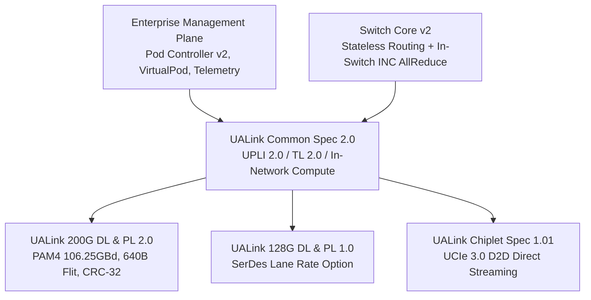

# UALink 2.0 Modular Architecture Prototype (`ualink_v2`)

Python reference implementation of the **UALink 2.0 Modular Specification Ecosystem**.



## Modular Directory Structure

- `common_v2/`: UALink Common Specification 2.0
  - In-Network Compute (INC) reduction engine (FP32, FP16, INT32)
  - UPLI 2.0 interface & credit management
  - Transaction Layer 2.0 (64B TL Flits)
  - Pluggable Transport Layer abstraction (`ITransportLayer`)
- `phy_dl_200g/`: 200G DL & PL 2.0 (640B Flits, CRC-32, Replay buffer)
- `phy_dl_128g/`: 128G DL & PL 1.0 (PCIe-compatible SerDes framing)
- `chiplet/`: UALink Chiplet Spec 1.01 (UCIe 3.0 D2D streaming)
- `manageability/`: Pod Controller v2, Virtual Pod isolation, Telemetry
- `switch_v2/`: Switch core with hardware collective reduction
- `simulation/`: End-to-end A-Z trace testbench (`testbench_v2.py`)
- `tests/`: Automated pytest suite (`test_all_v2.py`)

## Running Verification

```powershell
# Run unit tests
python -m pytest ualink_v2/tests/test_all_v2.py -v

# Run End-to-End Simulation with Deep Trace
python -m ualink_v2.simulation.testbench_v2
```
